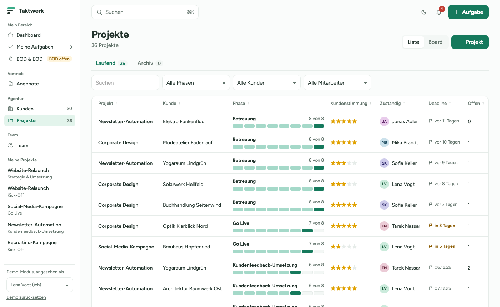
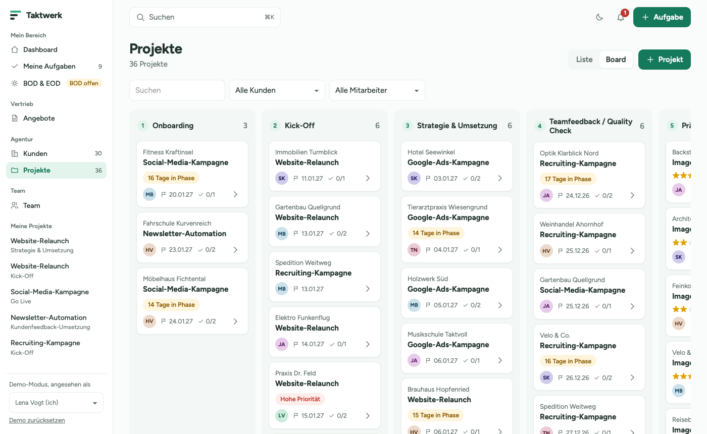
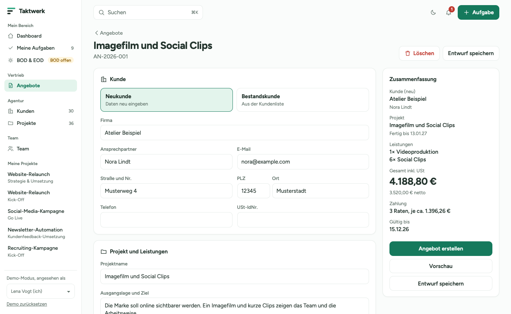
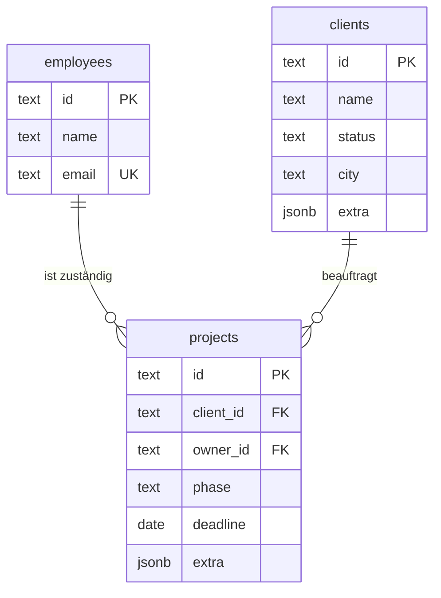

# Taktwerk

Internes Tool für eine (fiktive) Marketingagentur: Kunden, Projekte, Aufgaben, Tagesberichte und Angebote an einem Ort. Persönliches Demo-Projekt, **mit KI-Unterstützung entwickelt**. Alle Personen und Firmen sind ausgedacht.

**[Live-Demo](LINK-EINTRAGEN)** (ohne Login, Daten bleiben im eigenen Browser)

## Worum geht es?
In vielen Agenturen liegen Kundendaten, Projektstände und Absprachen in verschiedenen Listen. Taktwerk bildet den Ablauf vom Angebot bis zur Betreuung in **acht festen Phasen** ab und zeigt, wo ein Projekt steht, wer zuständig ist und wo es hängt.

## Was kann es?
- **Projekte** als Liste (sortier- und filterbar) oder Kanban-Board, mit Timeline, Checklisten und Phasenverlauf
- **Kunden** mit Stammdaten, Status und Zufriedenheit
- **Aufgaben und Termine** mit Kalender, Zuweisung und Teilnehmenden
- **Beginning of Day / End of Day**: Tagesplan und Abschluss, synchron zu den Aufgaben
- **Angebote** mit Zahlungsplan, PDF und Online-Unterschrift; danach wird das Projekt automatisch angelegt

| Board | Angebot |
|---|---|
|  |  |

## Datenmodell

- **PostgreSQL (Supabase)** für Kunden, Projekte und Mitarbeitende
- **Fremdschlüssel** verhindern Projekte ohne gültigen Kunden, **Prüfregeln** verhindern unbekannte Phasen
- **Row Level Security**: Nur angemeldete Personen aus `employees` sehen Daten
- **CSV-Import** mit einem absichtlich fehlerhaften Datensatz und einem versteckten Doppelten als Qualitätstest ([Daten](supabase/daten), [SQL](docs/abfragen.sql))

## Mein Anteil und der Anteil der KI
| Ich | KI |
|---|---|
| Idee, Anforderungen und Ablauf der Phasen | Programmcode der App |
| Bedienkonzept in vielen Runden getestet und verbessert | Vorschläge zu Technik und Aufbau |
| Tabellen und Beziehungen in Supabase angelegt, Daten importiert, SQL ausgeführt | Beispieldaten, SQL-Regeln und automatische Tests |
| Anbindung getestet, Daten auf Plausibilität geprüft | Fehlersuche und Dokumentation |

## Grenzen
Prototyp, nicht im Einsatz. Aufgaben, Angebote und Berichte liegen nur im Browser, der Kalender ist simuliert, der Angebotslink funktioniert nur im selben Browser. Die Signatur ist eine einfache elektronische Signatur und nicht rechtlich geprüft.

## Starten
`index.html` öffnen, dann läuft die Demo. Mit eigener Datenbank: [Anleitung](supabase/ANLEITUNG_SUPABASE.md).

Technik: JavaScript mit Preact, ohne Build-Schritt; Supabase (PostgreSQL, Auth).
